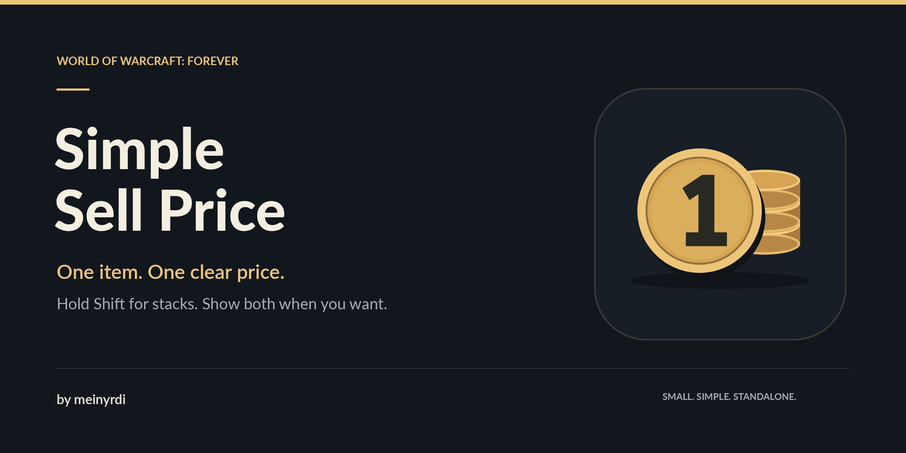
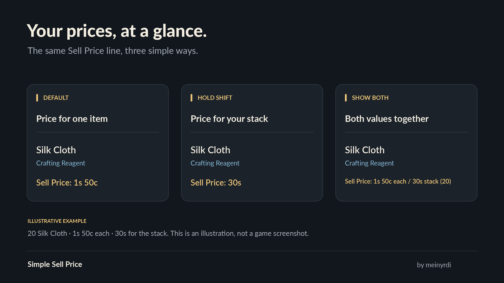

# Simple Sell Price

**Unit sell prices at a glance. Hold Shift for the stack.**

A small standalone addon for **World of Warcraft: Forever 1.60.1**, made by
**meinyrdi**. It uses the existing **Sell Price** line in bag item tooltips.

- See the vendor value of **one item** by default.
- **Hold Shift** to see what the hovered stack sells for.
- Turn on **Show both prices** to keep unit and stack values on the same line.
- Open the two simple settings from a small, movable minimap button or `/ssp`.

No dependencies, bag replacement or auction scan required.



*Illustrative example; the game supplies your tooltip's appearance and prices.*

## Install

1. Download `SimpleSellPrice-1.0.2-Camelot.zip` from
   [GitHub Releases](https://github.com/marxnus/simple-sell-price/releases/latest).
2. Extract it into your Forever installation's `Interface/AddOns` folder.
   The final path should be
   `Interface/AddOns/SimpleSellPrice/SimpleSellPrice_Camelot.toc`.
3. Start or restart the game and enable **Simple Sell Price** in the AddOns list.

## Settings

Click the minimap button, or type `/ssp` or `/simplesellprice`.

| Setting | What it does |
| --- | --- |
| Show unit and stack prices together | Shows both values on the existing Sell Price line, labelled `each` and `stack`, with the stack count. Single items keep one price. |
| Show minimap button | Shows or hides the button. `/ssp` still opens settings when it is hidden. |

Drag the button around the minimap to move it. Drag the window's title to move
the settings window; Escape or its close button dismisses it. Changes apply
immediately. Settings and the minimap position are shared across characters on
the same account.

## Compatibility

For **WoW Forever / Camelot**, interface **16001**. Supports Blizzard's bag
tooltips and compatible bag addons that use the native `SetBagItem` path.
The unit value comes from the actual hovered stack's vendor quote and quantity.
Other tooltip contexts retain their normal prices. This addon displays vendor
sell values; it does not estimate auction prices.

## Development

The price-switching behavior was confirmed in game in 1.0.1. Version 1.0.2 adds
artwork and author information without changing that behavior. The Lua 5.1 test
suite covers pricing, modifier changes, settings, persistence data and native
fallbacks. Further client checks are listed in
[tests/live-acceptance.md](tests/live-acceptance.md).

To build, use Python 3 with Pillow and Lua 5.1:

```sh
python3 tools/package.py --lua lua5.1 --luac luac5.1
```

This checks syntax, builds the runtime-only ZIP and tests a fresh extraction.
See [release instructions](docs/RELEASING.md) and the
[changelog](CHANGELOG.md). Report bugs on
[GitHub Issues](https://github.com/marxnus/simple-sell-price/issues).

## Credits and license

Made by **meinyrdi**. Code and original project artwork are available under the
[MIT license](LICENSE). Artwork sources and generation details are in
[art/PROVENANCE.md](art/PROVENANCE.md).

World of Warcraft is a trademark of Blizzard Entertainment. This is an
independent community addon.
